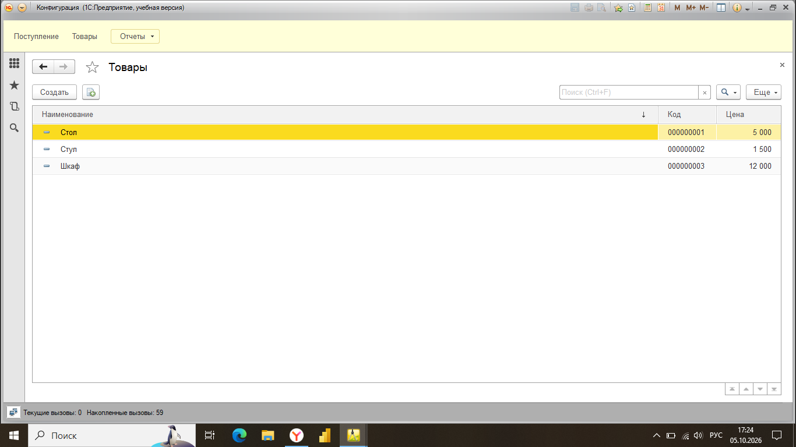
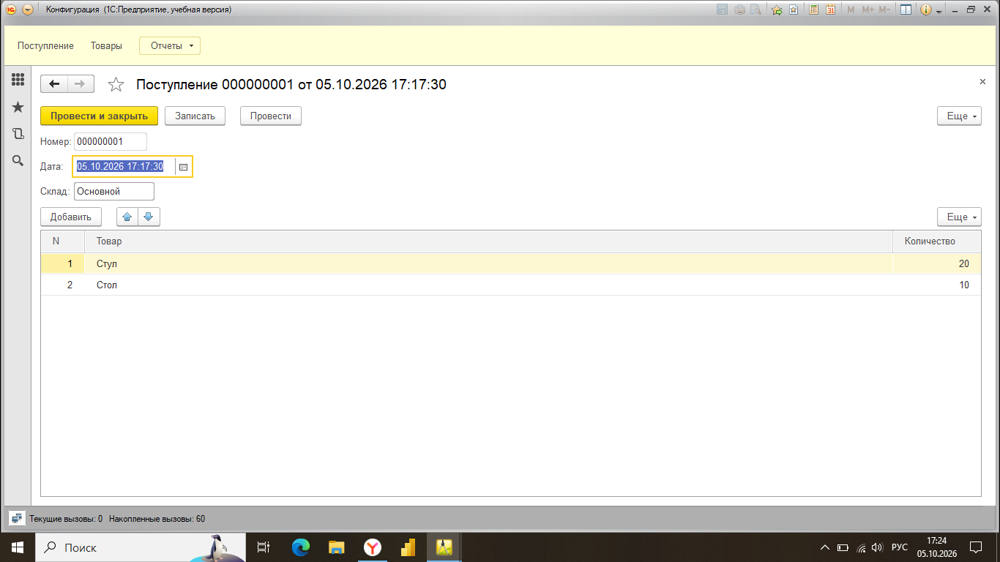
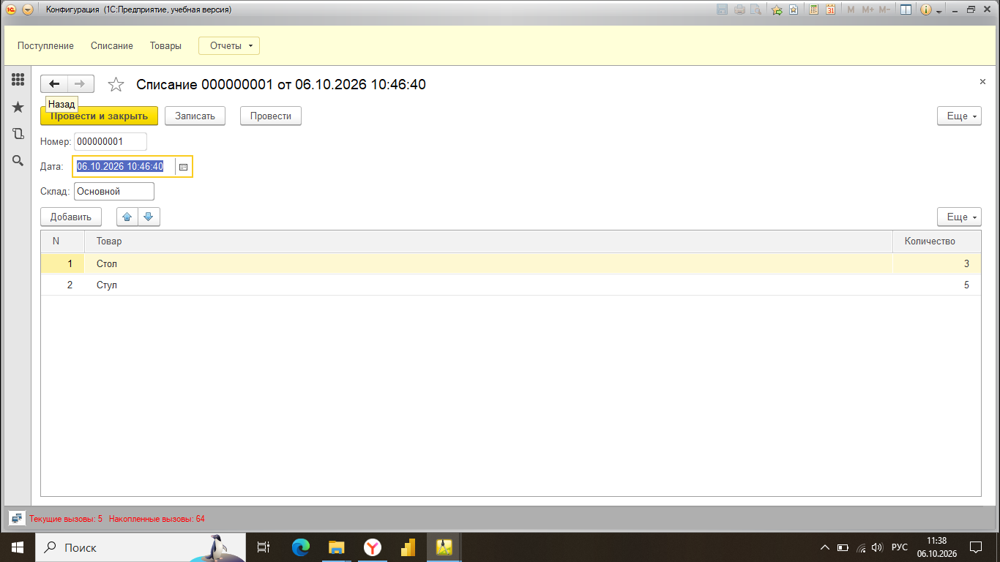
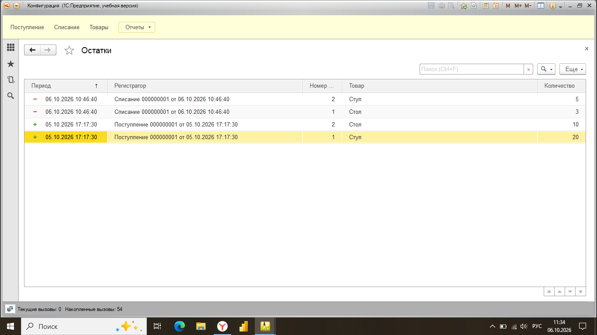
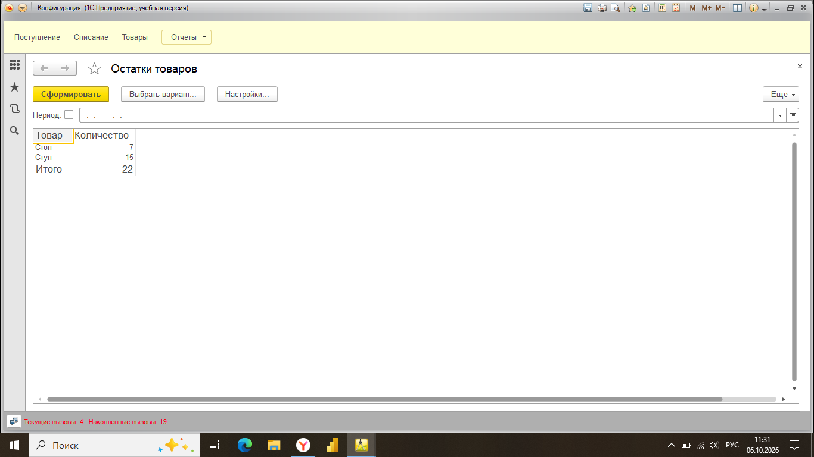

# Складской учёт на 1С:Предприятие 8.3

## Описание проекта
Учебная конфигурация для автоматизации складского учёта. Реализованы приход, расход и контроль остатков товаров.

## Функциональность
- **Справочник «Товары»** — хранение номенклатуры с ценой
- **Документ «Поступление»** — приход товара на склад
- **Документ «Списание»** — расход товара
- **Регистр накопления «Остатки»** — учёт движений (приход/расход)
- **Отчёт «Остатки товаров»** — итоговые остатки через СКД

## Скриншоты

### Справочник «Товары»

### Документ «Поступление»

### Документ «Списание»

### Регистр «Остатки» (движения)

### Отчёт «Остатки товаров»

## Технологии
- 1С:Предприятие 8.3 (учебная версия)
- Конфигуратор 1С
- Встроенный язык 1С
- Схема компоновки данных (СКД)

## Что реализовано
1. Создание объектов метаданных (справочники, документы, регистры)
2. Настройка движений документов через конструктор
3. Написание кода на встроенном языке 1С (обработка проведения)
4. Построение отчёта на СКД с использованием виртуальной таблицы остатков

## Как запустить
1. Установить 1С:Предприятие 8.3 (учебная версия)
2. Создать новую информационную базу «Без конфигурации»
3. В Конфигураторе воспроизвести структуру по скриншотам
4. Или загрузить файл конфигурации (.cf) — если приложен

## Автор
[NotFormal20]